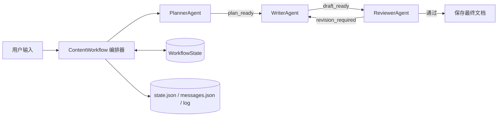

# 设计文档

## 1. 项目目标

项目实现一个小而完整的内容创作 Workflow。三个 Agent 分别负责规划、写作和审校，编排器负责顺序执行、条件分支、循环、状态持久化与错误处理。

默认使用本地确定性逻辑，便于离线演示和测试。传入 API client 后，三个 Agent 改用 OpenAI-compatible Chat Completions 接口；客户端由编排器注入 Agent，不改变消息记录和共享状态结构。

## 2. 架构

## 3. Agent 职责

| Agent | 输入 | 输出 | 边界 |
|---|---|---|---|
| PlannerAgent | 主题、读者 | 标题、目标、章节、质量要求 | 不撰写正文 |
| WriterAgent | 规划、审校意见 | Markdown 初稿或修订稿 | 不决定是否通过 |
| ReviewerAgent | 规划、草稿 | 分数、维度评分、修改意见 | 不直接修改草稿 |

## 4. 流程控制

主流程按 `planning -> writing -> reviewing` 顺序执行。ReviewerAgent 返回 `approved=false` 时进入 `revising`，WriterAgent 根据反馈修改后回到 `reviewing`。达到 `max_revisions` 仍未通过时，流程进入 `failed`，保留状态和错误信息。

首轮草稿缺少“审校后的改进摘要”，因此审校 Agent 会要求返工。修订稿响应反馈后通过复审，便于演示真实的条件循环。

## 5. 通信与状态

所有 Agent 共享一个 `WorkflowState`，但通过明确的消息记录表达协作关系。每条消息包含：

- `sender` 和 `recipient`
- `kind` 消息类型
- `payload` 结构化载荷
- `created_at` 时间

状态在每个关键步骤写入 `state.json`。`--resume` 会加载检查点，跳过已完成的规划或写作步骤。

## 6. 可扩展性

- 新增 Agent：继承 `BaseAgent`，实现 `execute`，在编排器中注册步骤。
- 修改流程：在 `ContentWorkflow.run` 中增加分支或并行调度点。
- 接入大模型：把 Agent 内的确定性模板替换为 LLM 客户端，保持输入输出结构不变。
- 可视化：读取 `history` 和 `messages.json`，构建运行时间线或流程图。

## 7. 错误处理

编排器捕获异常，将异常类型与信息写入状态和日志，再保留检查点。业务失败与程序异常分开处理：达到最大返工次数返回 `failed`，程序异常在保存状态后重新抛出，便于定位问题。

## 8. 测试策略

- 端到端测试：验证 Workflow 完成、触发一次返工、最终文档存在。
- 通信测试：验证关键消息和状态历史已持久化。
- 失败分支测试：设置最大返工次数为 0，验证流程可控失败并保存错误状态。

